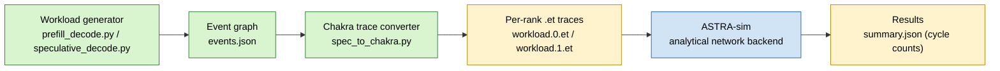
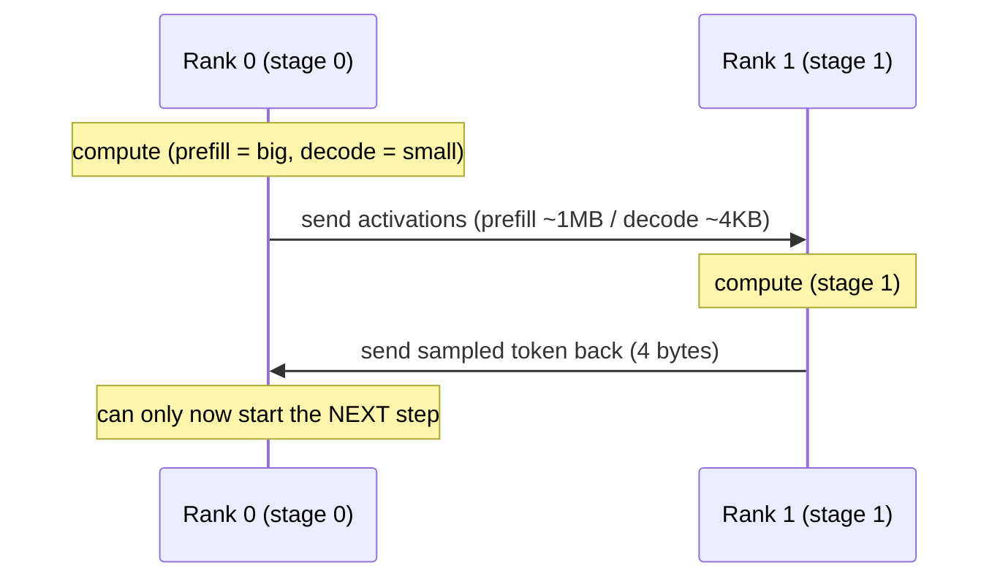

# Simple guide: what this project is doing (and where it's going)

Written to be readable without a hardware background. If you're new here, read
this first, then the real docs (`readme.md`, `scheduler/README.md`,
`NEXT_STEPS.md`).

---

## 1. The big idea in one picture

A chatbot (an LLM) answers you in two kinds of steps, and those steps send data
to each other over a tiny internal network. We are building a simulator to study
**how that network should decide who goes first when it gets busy.**

```
  Your question ──► [ compute ] ──send──► [ compute ] ──send token back──►
                      rank 0              rank 1
                        ▲                                   │
                        └─────────── next step waits ───────┘
```

Right now there are just **two compute units ("ranks") joined by one link**, and
**one request** flows through them, step by step.

---

## 2. Two things that sound similar but are NOT the same

This trips everyone up. There are **two different workloads** in this repo, and
they use different words. They do not mix.

### Workload A — "prefill / decode" (normal inference) — NOT speculative
File: `scheduler/workloads/prefill_decode.py`

- **Prefill** = the model reads your *whole prompt* at once. One big step, big
  data payload (default ~1 MB of activations).
- **Decode** = the model writes the answer *one token (word-ish) at a time*. Many
  small steps, tiny payloads (default 4 KB), and each step must wait for the
  previous token to come back (that's "autoregressive").
- Nothing here is guessed ahead of time. It's plain, honest, one-at-a-time.

### Workload B — "draft / verify" (speculative decoding) — IS speculative
File: `scheduler/speculative/speculative_decode.py`

- **Draft tokens** = a small fast model *guesses* the next `K` tokens ahead of
  time (default K = 4). These are the **speculative** ones — guesses.
- **Verify** = a big accurate model checks all the guesses at once and says how
  many it accepts. Accepted guesses are free speed; rejected ones are thrown away.
- `accepted_tokens` is just a label recorded for the experiment; this baseline
  only models one round, not the accept/reject/redo loop.

**So, which tokens are speculative?**

| Token word | Workload | Speculative (a guess)? |
| --- | --- | --- |
| prefill | A (normal) | No |
| decode | A (normal) | No |
| draft | B (speculative) | **Yes** — these are the guesses |
| verify result | B (speculative) | No (it's the check) |

Draft tokens and prefill/decode tokens never appear together. They are different
experiments.

---

## 3. Priority — is it actually used? (No, not yet)

Every network message gets a sticker. Two stickers exist:

- `phase` = "prefill" or "decode"
- `comm_priority` = a number (defaults to **0**)

**But nothing reads these stickers.** The network treats every message the same.
Setting a priority or a phase does **not** make any message go first today. This
is the single most important limitation: the labels ride along but change nothing.

---

## 4. The baseline scheduler — is it round-robin? (No, it's LIFO)

The current scheduling rule lives in
`scheduler/astra/configs/two_rank/system.json`:

```json
"scheduling-policy": "LIFO"
```

**What LIFO means here.** Per the official ASTRA-sim docs, `scheduling-policy`
sets the priority of **collectives** inside a rank's System layer: LIFO gives the
*most recently created* collective higher priority; FIFO is the reverse
(see the link in section 10). So it is **not** round-robin and **not** FIFO.

**Why is LIFO the default?** Two honest reasons:

1. **It's ASTRA-sim's own example default.** The project copied a standard,
   known-good example config so the simulator would run cleanly. LIFO is a common
   pick in these examples; it was not chosen to make any research point.
2. **With one request it changes nothing.** LIFO only matters when *several*
   collectives are queued at once and compete. Our current workload runs **one
   request, one thing at a time**, so there is never a queue to reorder. LIFO vs
   FIFO vs round-robin would all behave identically right now.

**Important nuance for your project.** This policy orders *collectives queued in
a rank*, not individual packets at a NoC router. A true phase-aware *router*
arbitration policy is a lower level than this knob. So you can't just flip this
field to "phase-aware" — that policy doesn't exist in the backend yet (see the
TODO flowchart in `flowcharts.md`).

**What "baseline" should mean.** Today there is **only this one policy** and **no
second policy to compare against.** A real study needs you to define an explicit
phase-unaware baseline (FIFO or round-robin) *and* a phase-aware policy, then run
both on the *same* busy workload. Until then, "baseline" just means "the plain
LIFO default we haven't compared against anything."

---

## 5. The pieces and how they connect

The data flows left to right. You own the green boxes; the blue boxes are tools
the project builds inside Docker.



And here is what actually happens *inside* one autoregressive step of the normal
prefill/decode workload (two ranks, one link, each step waits for the token to
come back):



| Piece | What it is | File / location |
| --- | --- | --- |
| Workload generator | Writes down every compute/send/receive step | `scheduler/workloads/`, `scheduler/speculative/` |
| Event model | The rules for a valid step graph | `scheduler/speculative/event_model.py` |
| Chakra generator | Translates steps into the simulator's file format | `scheduler/tracegen/spec_to_chakra.py` |
| ASTRA-sim | The actual network simulator that runs it | built in Docker at `/opt/astra-build` |
| Runner | Glues it all together, runs the sim, saves results | `scheduler/astra/run.py` |

Everything runs inside **Docker**, so you don't install anything but Docker.

---

## 6. How to run it

From the project root, with Docker running:

```bash
docker compose build          # first time only (takes a few minutes)
make simulate                 # run the normal prefill/decode workload
make speculative              # run the speculative draft/verify workload
make test                     # run the checks
```

Results land in `scheduler/results/raw/<timestamp>-.../summary.json`.

---

## 7. What is this hardware, really? (It's abstract on purpose)

Right now a "rank" is just an abstract compute+network endpoint. The code does
**not** say it's a wafer-scale chip, separate chips, or tiles — it currently
treats the two ranks as **two pipeline stages** of one model. The link (50 GB/s,
500 ns) is a generic placeholder, not a measured on-chip wire.

Picking what the hardware *is* is a decision we still have to make.

---

## 8. How to turn this into a Wafer-Scale-Chip NoC study

A Wafer-Scale Chip (WSC) is one giant chip made of many small **tiles**, all
wired together by an on-chip network (the **NoC** = Network-on-Chip). To move
from "two abstract stages" to "a NoC on a WSC," change these things in order:

1. **Decide a rank = a tile on the chip.** Write this down (this is step 2 in
   `NEXT_STEPS.md`). Everything below depends on it.

2. **Use a real on-chip topology instead of 2 fully-connected nodes.**
   Edit `scheduler/astra/configs/two_rank/network.yml`. A WSC NoC is usually a
   **mesh/grid** of many tiles, e.g.:
   ```yaml
   topology: [ Mesh2D ]     # instead of FullyConnected
   npus_count: [ 16 ]       # many tiles, not 2
   ```
   (You'll also need to update `scheduler/astra/run.py`, which currently assumes
   exactly two ranks.)

3. **Use believable on-chip numbers.** On-chip links are very fast and very
   short, so bandwidth goes up and latency goes down compared to the generic
   50 GB/s / 500 ns placeholder. Record where your numbers come from.

4. **Create traffic jams.** Generate **many requests at once** so prefill and
   decode messages actually fight for the same link. With only one request,
   there is nothing to schedule. (This is step 3 in `NEXT_STEPS.md`.)

5. **Actually make the NoC read the stickers.** Implement two schedulers and
   compare them on the same workload:
   - a **baseline** that ignores phase (e.g. FIFO or round-robin), and
   - a **phase-aware** one (e.g. "let decode go first, but don't let prefill
     starve").
   This is the real experiment and the point of the whole project (step 4).

6. **Measure what matters.** Record per-request/per-token numbers like
   **time to first token (TTFT)** and **time between tokens**, then compare the
   two schedulers. The runner does not extract these yet.

### Quick "where things are" cheat sheet for the conversion

| To change... | Edit this |
| --- | --- |
| Topology, number of tiles, link speed | `scheduler/astra/configs/two_rank/network.yml` |
| The scheduling rule (LIFO today) | `scheduler/astra/configs/two_rank/system.json` |
| How many requests / the traffic pattern | `scheduler/workloads/prefill_decode.py` |
| What metadata rides on each message | `scheduler/tracegen/spec_to_chakra.py` |
| The two-rank assumption in the runner | `scheduler/astra/run.py` |

---

## 10. Documentation to read so you can work on your own

Read these in order. The first group gets you productive in this repo; the second
group is the outside knowledge you need to actually change the simulator's
behavior (the NoC scheduling work).

### Group 1 — this repository (read first, ~1 hour)

| Order | File | Why |
| --- | --- | --- |
| 1 | `README_SUPPORT.md` (this file) | The plain-English overview you're reading |
| 2 | `readme.md` | Official top-level: Docker workflow + honest limitations |
| 3 | `NEXT_STEPS.md` | **The roadmap.** Your actual task list, step by step |
| 4 | `scheduler/README.md` | Every command, every parameter, output meaning |
| 5 | `flowcharts.md` | The "current" vs "TODO" data-flow diagrams |

### Group 2 — the code, in dependency order (read with the files open)

| Order | File | What you learn |
| --- | --- | --- |
| 1 | `scheduler/speculative/event_model.py` | The core data model: what a valid step graph is |
| 2 | `scheduler/workloads/prefill_decode.py` | How the normal workload is built |
| 3 | `scheduler/speculative/speculative_decode.py` | How the speculative workload is built |
| 4 | `scheduler/tracegen/spec_to_chakra.py` | How steps become Chakra `.et` traces |
| 5 | `scheduler/astra/run.py` | How it all runs and how results are parsed |
| 6 | `scheduler/astra/configs/two_rank/*` | The topology / scheduler / memory knobs |
| 7 | `scheduler/tests/test_workflows.py` | What "correct" means; copy these patterns |

### Group 3 — external docs (the knowledge the repo can't give you)

- **ASTRA-sim docs (start here, most important):**
  <https://astra-sim.github.io/astra-sim-docs/index.html>
  - System config (this is where `scheduling-policy: LIFO`, endpoint delay,
    collectives, etc. are defined):
    <https://astra-sim.github.io/astra-sim-docs/getting-started/argument-system-config.html>
- **Analytical network backend docs** (topology, bandwidth, latency — the
  `network.yml` knobs, and what the analytical model can and cannot tell you):
  <https://astra-sim.github.io/astra-network-analytical-docs/index.html>
- **Chakra user guide** (the trace format your converter writes; node types,
  attributes, dependencies):
  <https://github.com/astra-sim/chakra/blob/0e3cd40c569f0a4cacb6d961bb56be53407abd2f/USER_GUIDE.md>
- **ASTRA-sim paper** "Modeling Hierarchical Networks and Disaggregated Systems"
  (explains wafer-scale nodes and multi-dimensional topologies — directly
  relevant to the WSC/NoC goal): <https://arxiv.org/abs/2303.14006>

### Background concepts worth a quick read if they're new to you

- **LLM inference: prefill vs decode** — why the first step is compute-heavy and
  later steps are memory/latency-bound. (Any good "LLM inference explained" post.)
- **Speculative decoding** — the draft/verify trick (for workload B).
- **Network-on-Chip (NoC) basics** — routers, links, virtual channels, mesh
  topology, and arbitration. This is the vocabulary of step 4.
- **TTFT and inter-token latency** — the metrics you'll report.

### A tip for working without hand-holding

Follow `NEXT_STEPS.md` literally, one numbered step at a time, and do **not**
skip ahead. Each step ends with a "**Done when:**" line — treat that as your
definition of finished. Step 2 (writing the experiment spec: "a rank = a tile on
a WSC," pick a mesh, pick link numbers) is the one to do first, because every
later step depends on that decision.

---

## 11. One-paragraph summary

We built a working pretend world: we describe an LLM's compute-and-send steps,
turn them into Chakra trace files, and run them through the ASTRA-sim network
simulator to get timing numbers. Two separate workloads exist — normal
(prefill/decode) and speculative (draft/verify, where "draft" tokens are the
guesses). Today only one request runs at a time, the network scheduler is LIFO,
no phase-aware policy exists, and the phase/priority labels change nothing. To
make it a real Wafer-Scale-Chip NoC study we need a mesh of many tiles, many
overlapping requests, per-token metrics, and an actual phase-aware scheduler
compared against a plain baseline.
